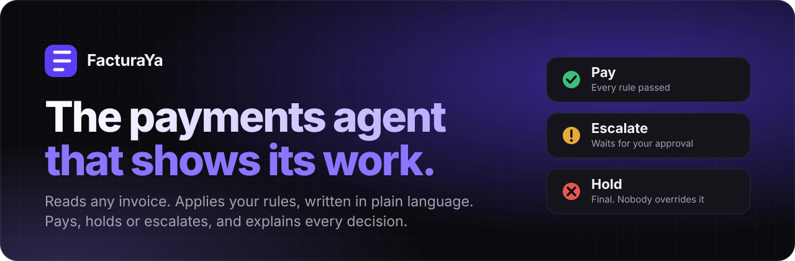
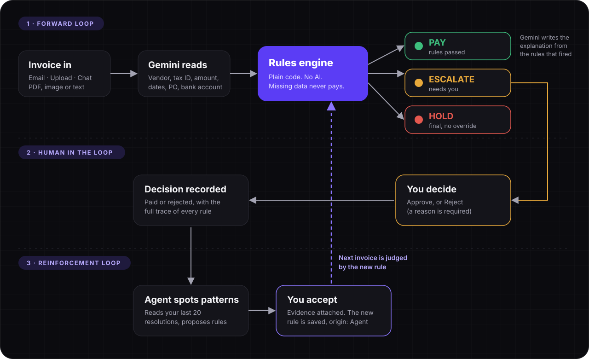
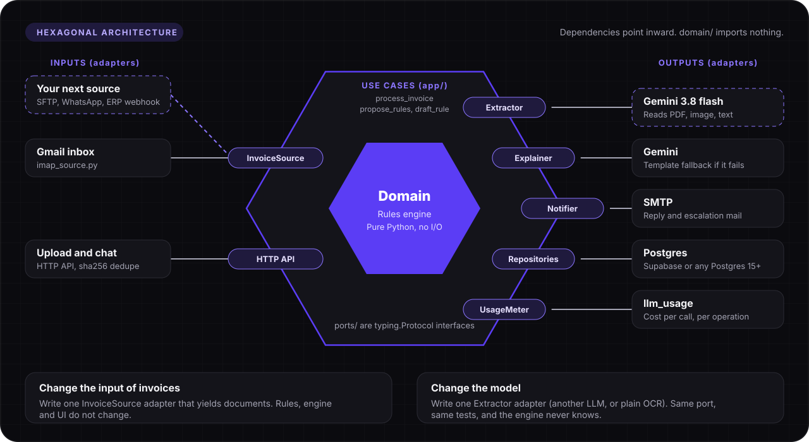

<div align="center">



<br>

**English** · [Español](README.es.md)

[Quick start](#quick-start) · [Docs](#docs) · [How it works](#how-it-works) · [Architecture](#architecture) · [Live demo](https://52.207.93.205.sslip.io)

<br>

[](https://52.207.93.205.sslip.io)


</div>

<br>

> Built for the **Blinka** challenge. FacturaYa is a fictional US company that pays suppliers in Colombia, Mexico, Brazil and the US from one USD account. Its agent reads each invoice, checks it against the company's rules and decides. You never have to guess why.

## Quick start

**Requirements:** Docker, [`uv`](https://docs.astral.sh/uv/) (Python 3.12) and Node 20+. A Postgres 15+ (a free [Supabase](https://supabase.com) project works) and a [Gemini API key](https://aistudio.google.com/apikey).

```bash
git clone https://github.com/devsergioherrera/payagent.git && cd payagent
cp .env.example .env            # then fill it in, see below
scripts/setup-db.sh             # schema, rules, vendors, purchase orders and October history
docker compose -f docker-compose.yml -f docker-compose.dev.yml up --build
```

Open <http://localhost> and sign in with `ADMIN_PASSWORD`. The frontend is also on `:3000` and the API on `:8000`. Code is mounted and reloads on save.

### Configuration (`.env`)

| Key | What it is |
|---|---|
| `DATABASE_URL` | Any Postgres 15+. Supabase pooler URL works. |
| `GEMINI_API_KEY` | Extraction, explanations, rule drafting, voice transcription. |
| `ADMIN_PASSWORD` · `SESSION_SECRET` | The single web login and the key that signs its cookie. |
| `GMAIL_ADDRESS` · `GMAIL_APP_PASSWORD` · `APPROVER_EMAIL` | Optional. The agent's inbox (use a Gmail [app password](https://support.google.com/accounts/answer/185833)) and who gets escalation emails. |
| `DOMAIN` | Empty for local. Set to a hostname in production and Caddy issues the HTTPS certificate. |

### Connect the email inbox (optional)

Invoices mailed to `GMAIL_ADDRESS` are picked up and answered in the same thread. The worker is off by default in dev:

```bash
docker compose -f docker-compose.yml -f docker-compose.dev.yml --profile email up --build
```

> **Warning:** never run the dev email worker while production is up. Both would read the same inbox.

## Docs

| Document | What is in it |
|---|---|
| [ROADMAP.md](docs/ROADMAP.md) | Design decisions, the 16 seed rules, who owns what, what gets cut first. |
| [BITACORA.md](docs/BITACORA.md) | The build log: current state, in progress, pending. Read it first when resuming. |
| [SPEC.md](docs/SPEC.md) | The original specification. Where it disagrees with the roadmap, the roadmap wins. |
| [AGENTS.md](AGENTS.md) · [CLAUDE.md](CLAUDE.md) | Rules for AI agents working in this repo (worktrees, CodeGraph, contracts). |
| [rules.md](docs/rules.md) · [reto_hackathon30x.txt](docs/reto_hackathon30x.txt) | The challenge brief. |
| [db/migrations/](db/migrations/) | The data model as SQL. `001_schema.sql` is the starting point. |

## What it does

| | |
|---|---|
| **Reads anything** | PDF, image, plain text or an email to the agent's inbox. Gemini extracts vendor, tax ID, amount, currency, dates, purchase order and bank account. |
| **Decides with rules, not vibes** | A deterministic engine (plain code, no AI) applies your active rules. Same invoice, same answer, every time. |
| **Three outcomes** | **Pay**, **Escalate** (waits for you) or **Hold** (final, nobody overrides it). Priority: Hold > Escalate > Pay. |
| **Explains itself** | Every decision shows each rule that was checked, what it saw and the limit. Gemini writes the summary only from the rules that fired. |
| **Rules in plain language** | Say *"don't pay more than 5k without me"*. Gemini drafts a structured rule, you preview it and approve it. It never writes SQL and never decides. |
| **Learns from you** | After you approve or reject, the agent notices patterns and proposes new rules, with the invoices as evidence. |
| **Fails closed** | Missing data never pays: it escalates. Allow-rules can never cancel a Hold or the human approval threshold. |

## How it works

<div align="center">

</div>

1. **Forward loop.** An invoice comes in, Gemini reads it, the rules engine decides Pay, Escalate or Hold.
2. **Human in the loop.** Escalations wait for you. Approve, or reject with a mandatory reason. Everything is recorded with its full trace.
3. **Reinforcement loop.** The agent reads your last 20 resolutions and proposes rules. You accept, the rule joins the rulebook (origin: Agent) and the next invoice is judged by it.

### The 16 seed rules

| Hold | Escalate |
|---|---|
| Blocked vendor · Month budget exhausted · Exact duplicate | Unknown vendor · Bank account or tax ID differs · Over USD 5,000 · Human threshold USD 10,000 · Possible duplicate (30 days) · No valid purchase order · Over PO tolerance (5 %) · Currency differs from PO · Missing fields · Date out of range · Overdue · PO over-billed |

Rules are conditions `source.column operator value`, joined by AND. Sources are any table or view registered in `rule_source`, so a new data source (an ERP receipt table, say) needs no engine change.

## Architecture

The engine sits at the center and knows nothing about email, Gemini or Postgres. Everything it touches goes through a port (a `typing.Protocol`), and each port has an adapter you can swap.

<div align="center">

</div>

- **Change where invoices come from.** Implement `InvoiceSource` (one `poll(handle)` method). Gmail is one adapter; an SFTP drop, a WhatsApp bot or an ERP webhook would be another.
- **Change the model.** Implement `Extractor` (and `Explainer`) and wire it in `app/wiring.py`. Nothing in `domain/` or the rules changes.
- **Change the database or the mailer.** Same idea with the repository and `Notifier` ports.
- **Prove it.** `domain/` imports nothing outside the standard library, so the engine is tested with no database and no network.

```
backend/    Python 3.12 · FastAPI · hexagonal: domain/ (pure engine) · ports/ · adapters/ (gemini, postgres, email, upload) · app/ (use cases) · api/
frontend/   Next.js (App Router) · shadcn/ui · lucide icons · polling every 3 s
db/         migrations + seed (Supabase / any Postgres)
deploy/     Caddyfile (HTTPS) · deploy.sh · bootstrap-vm.sh
scripts/    setup-db.sh · reset-demo.sh
docs/       SPEC.md · ROADMAP.md · BITACORA.md
```

`domain/` imports nothing outside the standard library, so the engine can be tested with no database and no network. The safety invariants are tests: `test_never_pay_when_any_block_fires` and `test_allow_never_overrides_hard_rules`.

```bash
cd backend && uv run --group dev pytest -q
```

## Screens

| Screen | For |
|---|---|
| **Mesa** | The desk: chat with the agent (upload an invoice, dictate, draft a rule, ask), live counters, pending approvals. |
| **Facturas** | Every invoice with search, filters and server-side pagination. |
| **Detail** | The decision, the trace of every rule, approve or reject. |
| **Reglas** | The rulebook, drafts, agent proposals and the reasoning behind them. |
| **Directorio** | Vendors, read-only. |
| **Costos** | What each LLM call cost. |

## Load test data

`scripts/setup-db.sh` seeds the fictional company: **6 vendors** (CO, MX, BR, US, one blocked), **9 purchase orders**, a **USD 60,000** monthly budget, **16 rules** and **10 invoices of history**. Three of those are Northwind invoices without a PO that you "approved", so **Propose rules** suggests an exception.

The 16 test invoices live in [`backend/tests/fixtures/invoices/`](backend/tests/fixtures/invoices/). Upload them from the UI, mail them to the agent, or run them all with `scripts/setup-db.sh --run-set`.

<details>
<summary><b>What each test invoice should do</b></summary>

| File | Case | Expected |
|---|---|---|
| 01–06 | Normal, with PO, in COP, USD, MXN and BRL (PDF, image, text) | Pay |
| 07 | Resend of 01 (exact duplicate) | Hold |
| 08 | Same vendor and amount as 02, 12 days later | Escalate |
| 09 | Unregistered vendor | Escalate |
| 10 | 8 % over the purchase order | Escalate |
| 11 | USD 12,000, above the human threshold | Escalate |
| 12 | Month budget exhausted | Hold |
| 13 | In COP, over the per-payment limit once converted | Escalate |
| 14 | Blurry image, unreadable amount | Escalate |
| 15 | Blocked vendor | Hold |
| 16 | Northwind without PO | Escalate, then  Pay after accepting the proposed exception |

</details>

Start over any time with `scripts/reset-demo.sh` (keeps only the history; `--run-set` reprocesses all 16).

## Production

One EC2 instance runs `docker compose` (API, worker, frontend, Caddy). **Deploys only happen through CD:** a push to `main` runs `.github/workflows/cd.yml`, GitHub assumes an IAM role by OIDC (no stored keys) and SSM runs `deploy/deploy.sh`. Pending migrations are applied before restart, and a deploy never resets data. Secrets live only in `.env`.

## Working with AI agents

This repo is indexed by CodeGraph (`.codegraph/`). Agents should query it before grepping:

```bash
codegraph explore "how does an escalation get resolved"
```

Read [`AGENTS.md`](AGENTS.md) and [`CLAUDE.md`](CLAUDE.md) for the rules, then [`docs/BITACORA.md`](docs/BITACORA.md) (current state, in progress, pending) and [`docs/ROADMAP.md`](docs/ROADMAP.md) (decisions and owners). Work goes in a worktree per vertical, with Conventional Commits.
